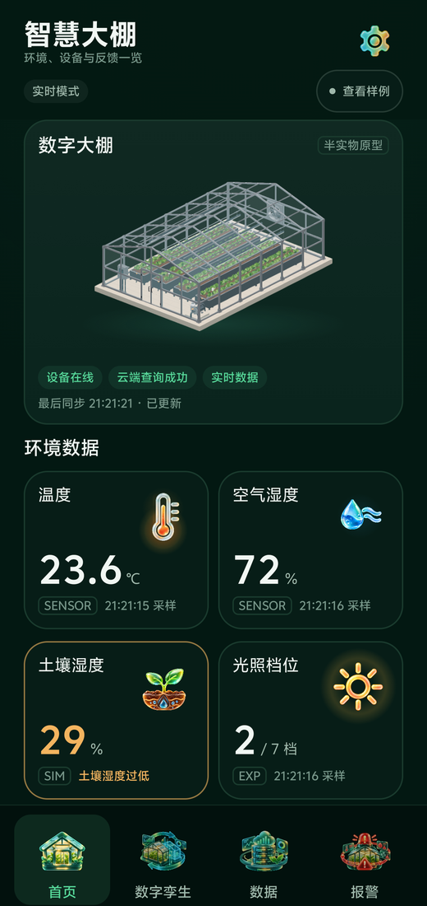
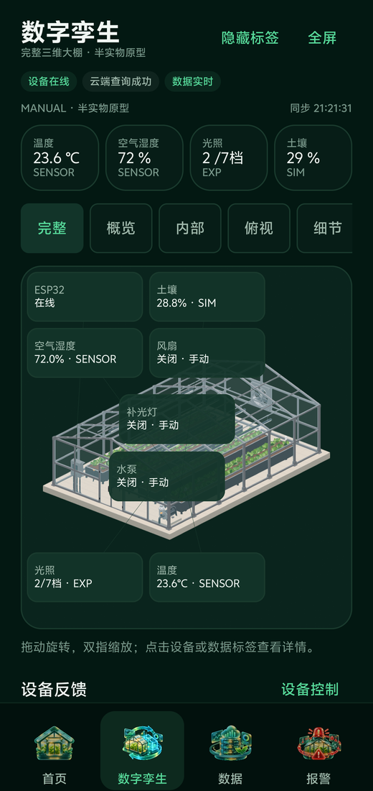
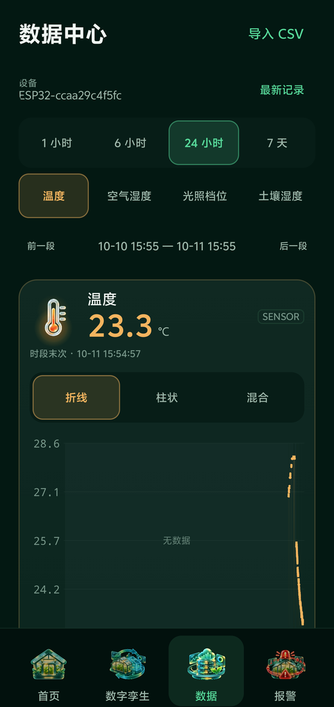
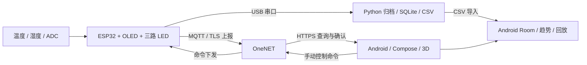

# 数字孪生智慧大棚

基于 **Android、ESP32 与 OneNET** 的智慧大棚半实物原型。把传感器读数、设备反馈、三维温室和历史记录放在同一条数据链路中，用于展示物联网采集、远程手动控制与数字孪生交互。

当前交付版本：**G5 · 0.5.0-g5-r01 · versionCode 9 · build02**。该版本已完成当前范围的实机验证并获项目使用者认可。

[下载 Android APK](https://github.com/gjhghjuh/digital-twin-greenhouse/releases/download/v0.5.0-g5-r01/greenhouse-g5-0.5.0-build02.apk) · [完整交付包与视频](https://github.com/gjhghjuh/digital-twin-greenhouse/releases/tag/v0.5.0-g5-r01) · [项目文档](第三版项目文档说明) · [交付清单](交付清单.json)

## 界面预览

<table>
  <tr>
    <th>环境与设备概览</th>
    <th>三维数字孪生</th>
    <th>历史数据中心</th>
  </tr>
  <tr>
    <td></td>
    <td></td>
    <td></td>
  </tr>
</table>

以上为 G5 验收时的真实手机界面，读数代表截图时刻。[35 秒实机录屏](https://github.com/gjhghjuh/digital-twin-greenhouse/releases/download/v0.5.0-g5-r01/g5-device-review-20261029.mp4) 展示模型旋转、首页和控制面板。

## 已实现功能

| 模块 | 当前能力 |
| --- | --- |
| 环境感知 | DS18B20 温度、DHT11 空气湿度、ADC 光照实验档位；分别标明来源与有效性 |
| 三维温室 | GLB 温室模型、旋转缩放、多视角、全屏、数据标签与设备状态联动 |
| 手动控制 | 水泵、补光灯、风扇三路手动控制；跟踪命令发送、设备结果及反馈确认 |
| 数据状态 | 分开表示云端查询、设备在线、数据新鲜度、最后已知值和未知状态 |
| 历史记录 | Room 本地存储、时间窗与指标筛选、趋势图、CSV 预览校验与去重导入 |
| 历史回放 | 时间轴、播放与暂停、真实缺口展示；回放期间禁止真实设备控制 |
| 手机端监测 | 阈值设置、当前与历史报警、环境建议；不自动驱动物理执行器 |
| 串口归档 | 独占串口，按契约校验记录，持久化 SQLite 与 snapshots/events CSV |

**实物范围：**温度和空气湿度来自传感器，光照是 ADC 实验值，土壤湿度为软件模拟值；三路外接 LED 分别代表水泵、补光灯和风扇。当前交付为 MANUAL 手动模式，AUTO、设备规则下发及设备本地报警跨端能力未纳入本次实现。

## 系统结构



主要技术：Kotlin、Jetpack Compose、Room、DataStore、Android KeyStore、SceneView / Filament、C++17、Arduino、PlatformIO、Python、JSON Schema。

## 仓库目录

```text
项目源码/
  android-app/          Android 应用、图标组件库、GLB 模型与资源
  esp32-firmware/       ESP32 固件、PlatformIO 配置、公开 CA 证书
  contracts/            记录、命令、引脚、运行参数与 CSV 列定义
  serial-archiver/      串口校验和归档工具
真实数据/2026-10-29/    新板实测快照与事件 CSV
第三版项目文档说明/    项目概述、设计、需求与 D7 阶段记录
assets/screenshots/    README 界面截图
HANDOFF.md             当前状态、历史进度与已知限制
交付清单.json          已交付原件的文件清单与 SHA256
```

保留四个源码子目录的相对位置。固件与归档工具会读取相邻的 `contracts/`，不要只复制单个源码文件运行。交付清单记录的是原交付 ZIP 的内容，README 与截图属于后续补充的仓库展示材料。

## 快速查看

1. 在 [Releases](https://github.com/gjhghjuh/digital-twin-greenhouse/releases/tag/v0.5.0-g5-r01) 下载 APK、完整包或视频。APK 为已验证的 **debug 版本**，最低 Android 7.0 / API 24；实测设备为 vivo V2301A / Android 14。
2. 安装后可查看页面与首页的固定视觉样例；固定样例不写入正式历史，也不代表真实设备在线。
3. 无硬件时，可将仓库 `真实数据/2026-10-29/` 中的 CSV 保存到手机，通过“数据”页的“导入 CSV”查看、确认并导入历史档案，再查看趋势和回放。
4. 真实云端读数与远程控制需要自己的硬件及有效 OneNET 授权配置。公开 APK 不携带本项目的云端密钥，不提供共享控制账号。

## 构建 Android

已验证的构建环境为 **JDK 21、Android SDK 36、Build Tools 36.0.0**。仓库使用 Gradle Wrapper 8.13、Android Gradle Plugin 8.13.2、Kotlin 2.0.21，代码目标为 Java 17。

```powershell
git clone https://github.com/gjhghjuh/digital-twin-greenhouse.git
Set-Location -LiteralPath 'digital-twin-greenhouse/项目源码/android-app'
.\gradlew.bat :app:assembleDebug --no-daemon --console=plain
```

先配置本机 `JAVA_HOME` 和 Android SDK，或用 Android Studio 打开 `项目源码/android-app` 并完成同步。首次构建需下载 Wrapper 和依赖；仅在已有完整依赖缓存时使用 `--offline`。

输出：`app/build/outputs/apk/debug/app-debug.apk`。重新构建产生的 debug 签名与文件哈希可能不同于 Release 中的已验收原件。

### 接入自己的 OneNET 设备

当前 APK 针对本项目设备构建，连接校验位于 [ConnectionStore.kt](项目源码/android-app/app/src/main/java/cn/greenhouse/twin/data/local/ConnectionStore.kt)。其中 `PROJECT_PRODUCT_ID`、`PROJECT_DEVICE_NAME` 固定了项目身份。使用其他云设备时，需要先调整这两个源码常量，并按 [云端映射](项目源码/contracts/onenet-mapping.json) 建立匹配的物模型、数据与命令映射，再重新构建。

应用读取私有目录 `files/connection-import.json` 中的授权配置，字段为 `productId`、`deviceName`、`accessKey`、可选的 `refreshSeconds`（至少 5 秒）。`accessKey` 为对应 OneNET API 的 Base64 密钥，与固件的设备密钥分开配置。成功导入后，应用将密钥转存到 Android KeyStore 保护的存储，并删除该明文导入文件。具体实现与联调过程见源码和 [D7 阶段记录](第三版项目文档说明)。

## 构建与烧录 ESP32

硬件为 **ESP32-WROOM-32 / esp32dev**，PlatformIO 环境名 `greenhouse`，平台锁定 `espressif32@7.1.3`，串口波特率 115200。VS Code 安装 PlatformIO IDE 后，打开 `项目源码/esp32-firmware`，即可在 Project Tasks 中查看 **Build / Upload / Monitor**。以下命令从仓库根目录开始：

```powershell
Set-Location -LiteralPath '项目源码/esp32-firmware'
Copy-Item network.local.example.json network.local.json
Copy-Item cloud.local.example.json cloud.local.json
```

在本地填写两份配置后再构建：

- `network.local.json`：2.4 GHz Wi-Fi 的 `ssid` 和 `password`；开放网络允许空密码。
- `cloud.local.json`：自己的 `productId`、`deviceName`、`deviceKey`、TLS 主机及端口 8883；按自己的 OneNET 配置核对，保留所需 CA 证书。

以下 `pio` 命令在 PlatformIO 终端，或已将 PlatformIO Core 加入 PATH 的终端执行：

```powershell
pio run -e greenhouse
pio device list
pio run -e greenhouse -t upload --upload-port COM7
pio device monitor --port COM7 --baud 115200
```

示例 `COM7` 应替换为本机实际串口。`configure.py` 会从契约和本地配置生成 `include/generated_config.h`，无需手写。固件、串口监视器与归档工具共用端口时，一次只运行一个串口占用程序。

### 实验接线

| 功能 | ESP32 GPIO |
| --- | --- |
| DS18B20 温度 | 4 |
| DHT11 湿度 | 27 |
| ADC 光照实验输入 | 36 |
| OLED SDA / SCL | 13 / 14 |
| 水泵 X1 / 补光灯 X2 / 风扇 X3 | 18 / 19 / 23 |

OLED 为 SSD1306 128×64、I²C 地址 `0x3c`；LED 高电平有效并串联限流电阻。完整参数以 [runtime.json](项目源码/contracts/runtime.json) 为准。不同开发板的排针布局可能不同，连接前须按 GPIO 丝印核对，断电后接线。

## 串口数据归档

使用 Python 3.11 或更高版本，并保留相邻契约目录。以下从仓库根目录开始：

```powershell
Set-Location -LiteralPath '项目源码/serial-archiver'
python -m venv .venv
.\.venv\Scripts\python.exe -m pip install -r requirements.txt
.\.venv\Scripts\python.exe archiver.py --list
.\.venv\Scripts\python.exe archiver.py --port COM7 --output '..\..\项目数据\local'
```

工具生成归档数据库和按 UTC 接收日期组织的 CSV。按 `Ctrl+C` 正常结束并释放串口后，再启动 PlatformIO Monitor。`contracts/` 中的协议示例用于理解格式，不能冒充真实采样导入正式历史。

## 验证范围与已知限制

- Android 与新 ESP32 之间的 OneNET 数据链路、手机水泵控制及 OLED / X1 响应已有实际验证；三路 LED 已分别完成本地亮灭观察。换板后手机另两路控制未重复实测。
- 新板真实 CSV 已导入；既有历史记录与归档表达逐条核对，无缺失或修改。历史缺口保持未知，不补成零值。
- 曾出现一次 USB 断电重接后需要复位，直接上电启动可靠性未完成重新验证。
- 连续切换三维界面的内存峰值偏高；长时无泄漏及 GPU 耗时未完成证明。
- 换板后保留 OneNET 逻辑设备名以关联历史，该名称不代表新板的物理 MAC；D5 的旧设备身份定义与现实现存在已记录的语义差异。
- 原设计文档保留阶段需求与历史状态；已实现范围以本 README、HANDOFF 最新记录及 G5 交付为准。AUTO 等未实现能力不应按原设计文档推断为已交付。

公开仓库与交付包均排除了本机 Wi-Fi / OneNET 私有配置、生成配置头、含凭据的固件二进制及构建缓存。重新构建需要自行配置；脱敏交付包尚未在完全干净的环境独立重建。

## 继续阅读

- [V3 项目设计与阶段记录](第三版项目文档说明)
- [当前进度和问题记录](HANDOFF.md)
- [交付原件与文件校验值](交付清单.json)
- [G5 安装包、完整 ZIP、D7 与实机录屏](https://github.com/gjhghjuh/digital-twin-greenhouse/releases/tag/v0.5.0-g5-r01)
